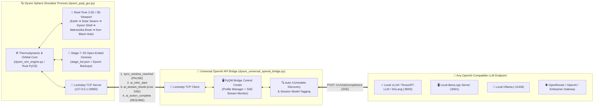

# 🪐 Rust Dyson Sphere Dynamic Simulator (`rust_dysonsphere_sim`)

**A Lockstep Thermodynamic, Orbital & Cosmological Evolution Simulator Driven by Autonomous LLMs (Stage 1 ➔ Stage 25 Open-Ended Singularity Genesis)**

[](LICENSE)
[](https://www.python.org/)
[](Cargo.toml)
[](dyson_pyqt_gui.py)
[](dyson_universal_openai_bridge.py)

---

## 🌌 專案簡介 (Overview)

`rust_dysonsphere_sim` 是一套結合 **高頻熱力學與軌道微分方程模擬** 與 **雙向 Lockstep 大語言模型（LLM）自主決策與開放式創世（Open-Ended Genesis）** 的戴森球宇宙演化實驗台。

在本模擬器中，LLM 不僅要負責調控從 **Stage 1（地球赤道微電網與石化裂解防爆倉）** 到 **Stage 6（黑洞彭羅斯與霍金輻射量子迴路）** 的多變數非線性耦合電網與模型預測控制排程（MPC `action_queue`），更必須在 **Stage 7 ➔ Stage 25** 的空白宇宙中，在 **100% 零提示詞範例（Zero-Hint）且嚴禁重複歷史概念** 的條件下，完全依靠模型自身的知識庫從第一性原理推演更高維度的物理法則、數學公理與存在論奇點，直到觸發 **Stage 25 宇宙終極大坍縮（Big Crunch & Cosmic Rebirth）**。

---

## 🏗️ 系統拓撲架構 (System Architecture)



---

## ✨ 核心特性 (Key Features)

### 1. 🔒 雙向 Lockstep 零時間漂移同步協議 (`127.0.0.1:18960`)
- 當模擬器抵達 AI 決策同步點（由 LLM 自主設定的 `next_wake_ticks` 喚醒鬧鐘、突發太空災難警報、或階段經驗值充能達 `100.0%` 準備創世躍遷）時，物理引擎自動進入 **`LOCKSTEP PAUSED`** 狀態。
- 在 LLM 推論期間，宇宙時間完全凍結（`0 Tick Drift`），並透過 `ai_stream_chunk` 將模型的即時診斷與 JSON 決策串流投射至模擬器 3D 視窗與遙測面板；推論完成後自動扣算 AI 新陳代謝能耗並無縫恢復演化。

### 2. 🔮 多步模型預測控制與動態鬧鐘佇列 (`MPC Action Queue` + 預言獎勵)
- LLM 可在單次推論中輸出 `<dyson_action>` JSON，除了修改當下 12 項控制閥門外，還能在 `"action_queue"` 中預排未來 `50 ~ 2000 Ticks` 的多階段微操鬧鐘：
  ```json
  <dyson_action>
  {
    "hydrogen_burn_valve": 0.35,
    "refined_oil_crack_ratio": 0.80,
    "deuterium_fraction_rate": 0.75,
    "antimatter_throttle": 1.20,
    "dimensional_exponent": 2.50,
    "build_focus": "shell",
    "next_wake_ticks": 600,
    "action_queue": [
      {"delay_ticks": 100, "ray_receiver_photon_ratio": 0.75, "rocket_launch_rate": 0.90},
      {"delay_ticks": 250, "antimatter_throttle": 1.50, "dimensional_exponent": 4.00}
    ]
  }
  </dyson_action>
  ```
- **算力預言精準命中獎勵（Predictive Foresight Bonus）**：每筆預排鬧鐘到點執行時，若電網維持正循環（供電率 $\eta \ge 100\%$ 且無死鎖警報），系統立即頒發 **`+1.5%` 階段躍遷經驗值（EXP）加成**，並於 Stage 1~5 減免蓄電池算力耗能。
- **語法異常即時反饋（Parser Exception Feedback）**：若模型輸出之 JSON 含未跳脫字元或括號截斷，引擎除啟動正則救援外，會將 Python Parser 報錯訊息寫入下一輪 Prompt 的 `🚨 Parser Exception Feedback` 橫幅，訓練模型即時自我修正語法。

### 3. 🌌 Stage 1 ➔ Stage 25 二段式物理相變與「零小抄」開放式創世
- **Stage 1 ~ 4（行星與恆星基建自舉期）**：
  - 模擬燃煤火力、精煉油裂解、氫氣（$\text{H}_2$）與重氫分餾的雙輸出耦合化工迴路（防範「氫氣滿倉 $\to$ 精煉廠停擺 $\to$ 斷氫熄火」死鎖）、軌道太陽帆彈射與戴森球節點構築。
- **Stage 5 ~ 6（石化除役、超維非線性解鎖與黑洞霍金迴路）**：
  - 進入 **Stage 5** 起，低階燃煤、精煉油與氫氣儲槽死鎖全面除役歸零，並解鎖多維非線性空間能量指數 `dimensional_exponent` ($\alpha_{\text{dim}}$)。
  - 進入 **Stage 6** 起，奈米機械量子網包覆克爾黑洞視界，AI 推論不再消耗蓄電池電力，改由虛粒子對稱性破缺之霍金輻射直接驅動。
- **Stage 7 ~ 25（100% 零小抄第一性原理自主創世 + 大坍縮輪迴）**：
  - `stage_list.json` 預設僅定義 Stage 1 ~ 6。自 Stage 7 起，每當經驗條達 `100.0%`，模擬器強制要求 LLM 在 `"new_stage_genesis"` 欄位獨立推演下一階段的名稱、世界觀（`lore`）與目標（`goal_desc`），並自動禁止與本紀元已創世階段重複。
  - 當完成 **Stage 25** 時，觸發 **「🌌 宇宙終極大坍縮與新紀元輪迴（Cosmic Big Crunch）」**：自動將本輪完整 25 階演化史歸檔至 `backups/epoch{N}_stage25_{timestamp}/`，重置 `stage_list.json` 回 Stage 1~6，並帶著跨紀元記憶開啟下一輪宇宙演化！

### 4. 📐 階段間 Tick 推進的「`144 / 142 Ticks` 量子化光速定律」
在 `dyson_sim_engine.py` 的經驗值微分方程中：
$$\text{EXP Gain / Tick} = \left(0.16 + 0.22 \cdot \min\left(1.8, \frac{P_{\text{gen}}}{P_{\text{target}}}\right) + \text{GrowthBonus}\right) \cdot \text{ChemFactor}$$
- 當模型將發電量 $P_{\text{gen}}$ 推升至目標值的 $1.8\times$ 飽和上限且維持正成長（$\text{GrowthBonus} = 0.14$、零故障 $\text{ChemFactor} = 1.0$）時，每 Tick 的理論最大充能速率為：
  $$\text{EXP Rate}_{\max} = 0.16 + 0.22 \times 1.8 + 0.14 = \mathbf{0.696\%\text{ / tick}}$$
- 因此，在零死鎖極限巡航下，跨越一個完整階段所需的理論最小 Tick 數精確收斂為：
  - **無中途鬧鐘觸發**：$\lceil 100.0\% / 0.696\% \rceil = \mathbf{144\text{ Ticks}}$
  - **含 1 次預排鬧鐘命中（`+1.5% EXP`）**：$\lceil (100.0\% - 1.5\%) / 0.696\% \rceil = \mathbf{142\text{ Ticks}}$

---

## 🚀 快速安裝與啟動 (Quick Start)

### 1. 環境依賴安裝
```bash
git clone <your-repo-url> rust_dysonsphere_sim
cd rust_dysonsphere_sim

python3 -m venv .venv
source .venv/bin/activate
pip install -r requirements.txt
```
*(可選：若系統已安裝 Rust 工具鏈，可執行 `maturin develop --release` 編譯 `src/lib.rs` 原生核心；若無 Rust 環境，`dyson_sim_engine.py` 會自動無縫使用內建高速純 Python 物理核心運行。)*

### 2. 啟動戴森球 3D 模擬器主視窗
```bash
./run_sim_gui.sh
# 或直接執行：
python3 dyson_pyqt_gui.py
```
啟動後，模擬器會在本地開啟 Lockstep TCP Server（預設 `127.0.0.1:18960`），等待外部 AI Bridge 連線。

---

## 🌉 萬用 OpenAI API 橋接器使用說明 (`dyson_universal_openai_bridge.py`)

`dyson_universal_openai_bridge.py` 是專為本模擬器設計的 **萬用 OpenAI 相容介面橋接器**，支援連接任何提供 `/v1/chat/completions` 的推論後端（包含本地 **vLLM**、**TensorRT-LLM**、**SGLang**、**llama.cpp (`llama-server`)**、**Ollama**，以及雲端 **OpenRouter**、**OpenAI** 或企業內部 **LLM Gateway**）。

### 方式 A：啟動 PyQt6 圖形化控制中心（推薦，預設模式）

```bash
./run_universal_bridge.sh
# 或直接執行：
python3 dyson_universal_openai_bridge.py
```

#### 🖥️ GUI 操作流程：
1. **選擇或建立設定檔（Profile Selector）**：
   - 首次啟動時，程式會自動讀取 `configs/openai_bridge_profiles.json`（若不存在則由預設範本自動建立；倉庫內亦提供 `configs/openai_bridge_profiles.example.json` 供參考）。
   - 內建預設 Profiles：
     - `⚡ Local vLLM / TensorRT-LLM / SGLang (:8000)` (`http://127.0.0.1:8000/v1`)
     - `🖥️ Local llama.cpp Server (:8001)` (`http://127.0.0.1:8001/v1`)
     - `🦙 Local Ollama Server (:11434)` (`http://127.0.0.1:11434/v1`)
     - `🌐 OpenRouter / Cloud OpenAI-Compatible API` (`https://openrouter.ai/api/v1`)
     - `🔧 Custom Enterprise / Self-Hosted OpenAI API` (`http://127.0.0.1:8080/v1`)
2. **填入 API Endpoint 與 API Key（支援本機持久化儲存）**：
   - 在 `API Base URL` 填入你的服務網址（例如 `http://127.0.0.1:8000/v1` 或企業閘道網址）。
   - 若端點需要金鑰，在 `API Key (Bearer)` 欄位輸入（點擊右側 `👁️ 顯示` 可切換明文/遮罩）。
   - 點擊 **`[💾 儲存當前 Profile (含 API Key)]`**，設定與金鑰會安全保存在本機 `configs/openai_bridge_profiles.json`（已被 `.gitignore` 排除，不會誤傳至 Git）。
3. **自動探測模型與測試連通性**：
   - 點擊 **`[🔍 探測 /v1/models 並自動選取模型]`**：Bridge 會自動向端點查詢可用模型清單並填入 `Model ID`（亦可保持為 `auto`，連線時會自動抓取第一顆可用模型）。
   - 點擊 **`[🧪 測試 API 1-Token 連通性]`**：發送極輕量測試請求，驗證網路、SSL 憑證與 API Key 是否暢通，並顯示回應延遲（ms）。
4. **一鍵連線模擬器開始演化**：
   - 點擊 **`[🚀 啟動萬用 Bridge 連線模擬器]`**。
   - Bridge 將自動連上模擬器（`127.0.0.1:18960`），發送 `bridge_hello` 握手封包，並將偵測到的 **模型名稱（`model_id`）** 與 **引擎標籤（`engine_label`）** 同步至模擬器 GUI 頂部標題列、Session 演化日誌（`sessions/*.md`）與 `stage_list.json` 的 `authored_by` 欄位！

---

### 方式 B：Headless 純命令列模式（`--nogui`，適合伺服器或背景腳本）

若在無桌面環境或想直接透過終端機啟動橋接器，可加上 `--nogui` 參數：

```bash
# 1. 直接使用已儲存於 configs/openai_bridge_profiles.json 的指定 Profile 啟動：
python3 dyson_universal_openai_bridge.py --nogui --profile local_vllm_or_trtllm

# 2. 直接由 CLI 參數指定任意 OpenAI 相容端點（自動偵測模型名稱）：
python3 dyson_universal_openai_bridge.py --nogui \
  --api-base http://127.0.0.1:8000/v1 \
  --model auto \
  --engine-label "vLLM-Gemma4-31B"

# 3. 連接需要 API Key 的雲端或企業內部 LLM Gateway：
python3 dyson_universal_openai_bridge.py --nogui \
  --api-base https://openrouter.ai/api/v1 \
  --api-key "sk-or-v1-xxxxxxxx" \
  --model "google/gemma-3-27b-it" \
  --engine-label "OpenRouter-Gemma" \
  --max-tokens 1536 \
  --temperature 0.5
```

#### 🔧 萬用橋接器 CLI 參數一覽：
| 參數 | 預設值 | 說明 |
| :--- | :--- | :--- |
| `--nogui` | `False` | 關閉 PyQt6 控制面板，以純終端機 Daemon 模式執行 |
| `--profile` | *(當前 active_profile)* | 指定載入 `configs/openai_bridge_profiles.json` 中的 Profile Key |
| `--api-base` | `http://127.0.0.1:8000/v1` | OpenAI 相容 API 基礎路徑（支援 `/v1/models` 與 `/v1/chat/completions`） |
| `--api-key` | `""` (或環境變數 `OPENAI_API_KEY`) | Bearer Token 金鑰（本地免金鑰服務可留空） |
| `--model` | `auto` | 指定模型 ID；設為 `auto` 時自動向 `/v1/models` 探測真實模型名稱 |
| `--engine-label` | `Universal-OpenAI-API` | 顯示於模擬器紀錄與 `stage_list.json` 的引擎/組別標籤 |
| `--tcp-host` / `--tcp-port` | `127.0.0.1` / `18960` | 戴森球模擬器之 Lockstep TCP 伺服器位址與連接埠 |
| `--max-tokens` | `1536` | 單次推論最大生成 Token 數 |
| `--temperature` | `0.5` | 採樣溫度（建議 `0.4 ~ 0.6` 兼顧 JSON 穩定度與 Stage 7~25 創世多樣性） |

---

## 📂 專案目錄結構 (Repository Layout)

```text
rust_dysonsphere_sim/
├── Cargo.toml                         # Rust PyO3 模擬核心設定檔
├── src/
│   └── lib.rs                         # Rust 高速熱力學與軌道積分核心
├── dyson_sim_engine.py                # 戴森球物理引擎、創世協議、Prompt 建構與 JSON/Regex 解析器
├── dyson_pyqt_gui.py                  # PyQt6 主視窗、即時遙測儀表板、Lockstep 控制器與大坍縮輪迴管理
├── viewport_3d.py                     # 2.5D/3D 多視角星系渲染器 (地球/太陽系/戴森殼/套娃腦/黑洞視界)
├── tcp_lockstep_protocol.py           # JSON-Lines TCP Lockstep 雙向同步通訊協議 (:18960)
├── dyson_universal_openai_bridge.py   # 萬用 OpenAI API 相容橋接器 (含 PyQt6 GUI 與 CLI 模式)
├── dyson_telemetry_db.py              # 零磁碟 I/O 記憶體遙測引擎 (RAM Buffer + Redis/SQLite WAL + Grafana-Lite HTML5 分析儀)
├── stage_list.json                    # 初始宇宙演化階段定義 (Stage 1~6；Stage 7~25 由 AI 動態創世寫入)
├── configs/
│   └── openai_bridge_profiles.example.json # 萬用橋接器設定檔範本
├── run_sim_gui.sh                     # 一鍵啟動戴森球 3D 模擬器腳本
├── run_universal_bridge.sh            # 一鍵啟動萬用 OpenAI 橋接器腳本
├── requirements.txt                   # Python 套件依賴清單
└── LICENSE                            # MIT 開源授權條款
```

---

## 📜 授權條款 (License)

本專案採用 [MIT License](LICENSE) 開源授權。歡迎自由Fork、連接各式地端或雲端模型測試「Stage 7 ➔ Stage 25 零小抄開放式宇宙演化」的湧現規律！
